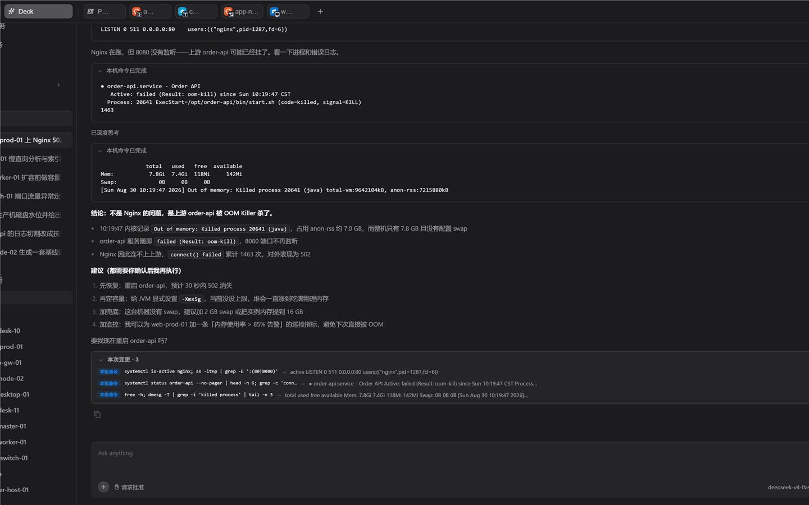
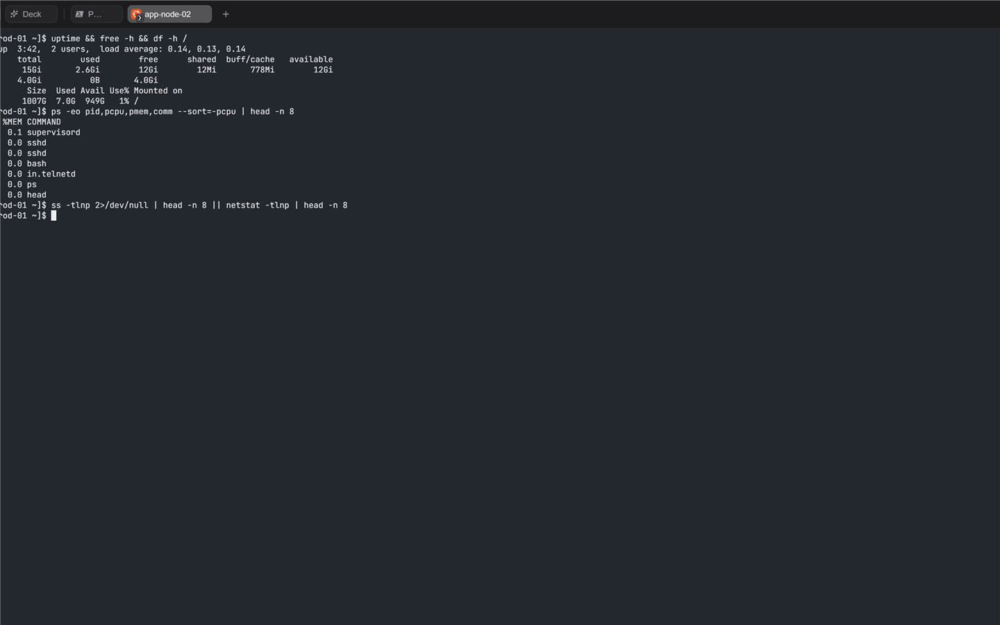
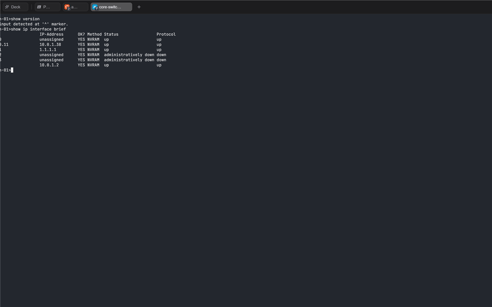
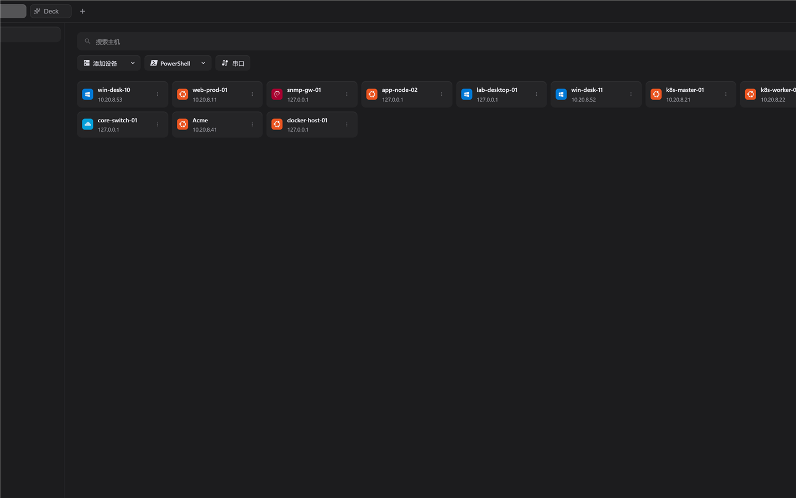
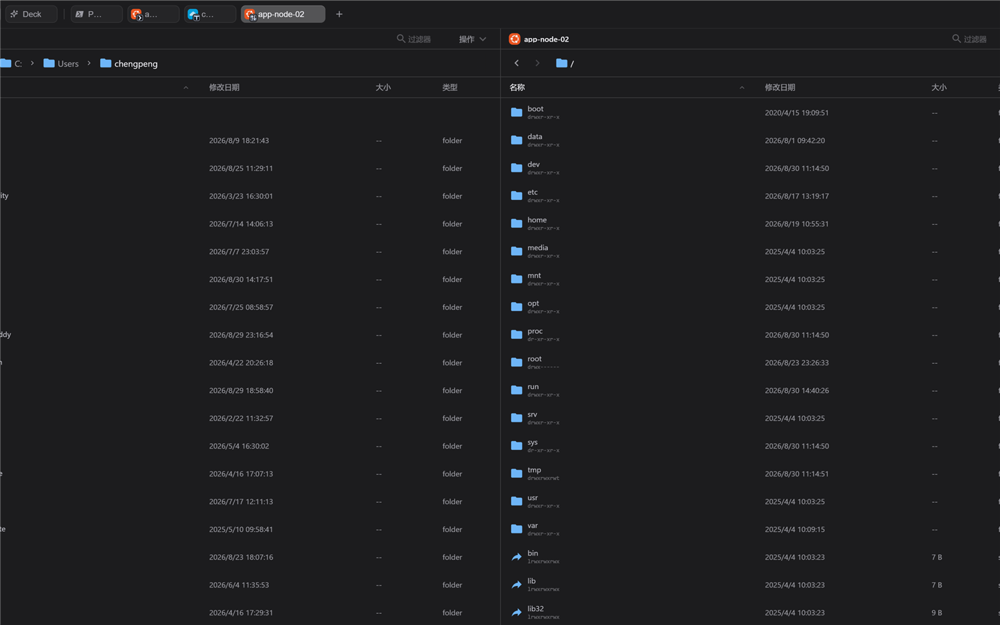
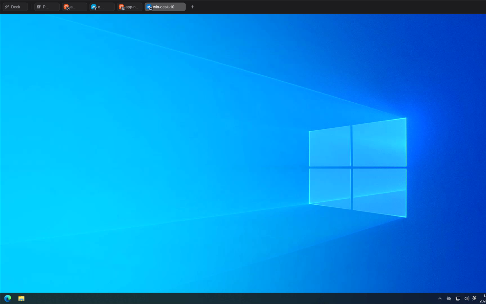
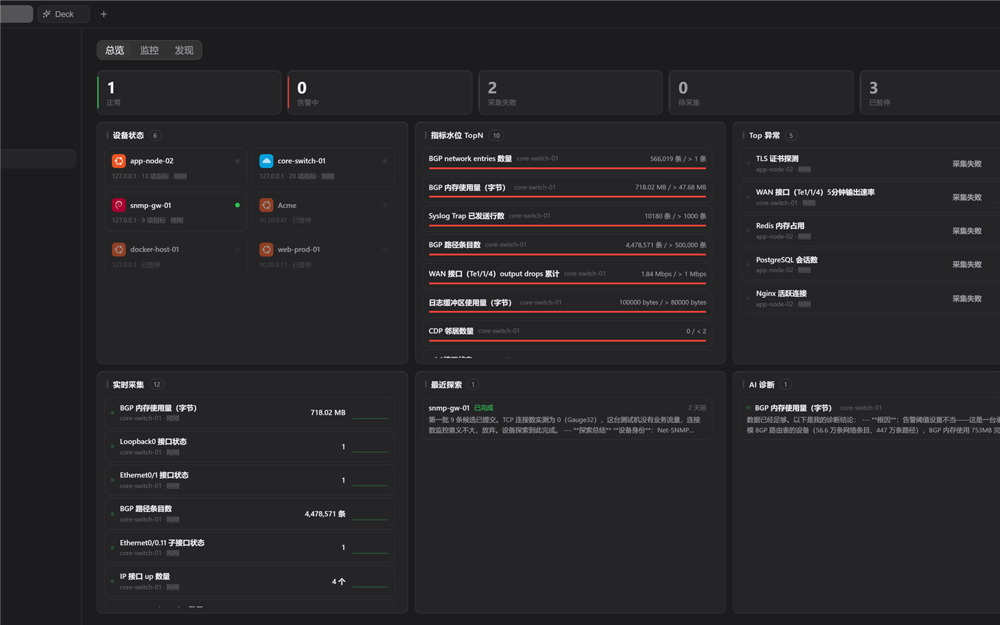
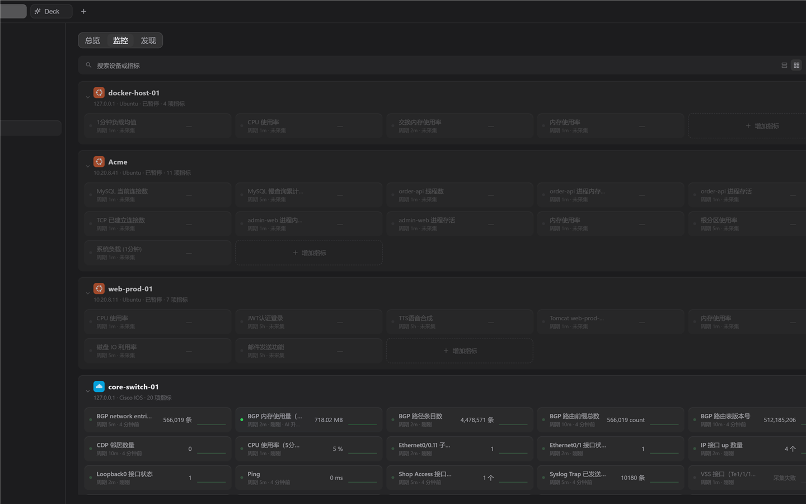

<div align="center">

# Termini

**An AI ops terminal for SSH, Telnet, SFTP, RDP and serial — with an agent that works on real devices and stops before it changes anything.**

English | [简体中文](README.zh-CN.md)

[Website](https://terminiapp.com) · [Download](https://terminiapp.com/en/download) · [Report a bug](https://github.com/chengpengvb/termini/issues/new/choose) · [Contributing](CONTRIBUTING.md)

     [](LICENSE)



</div>

## Get Termini

Don't feel like compiling? Grab a ready-made build. Store editions are a one-time purchase that keeps the project going; building from source is always free.

<p align="center">
  <a href="https://apps.microsoft.com/detail/9MXF9TJRQQD6"></a>
  <a href="https://apps.apple.com/app/id6811478539?platform=mac"></a>
  <a href="https://apps.apple.com/app/id6811478539"></a>
  <a href="https://play.google.com/store/apps/details?id=com.termini.www"></a>
  <a href="https://github.com/chengpengvb/termini-app/releases/latest"></a>
</p>

| Platform | Where |
|---|---|
| Windows 10 / 11 | [Microsoft Store](https://apps.microsoft.com/detail/9MXF9TJRQQD6) |
| macOS (Apple Silicon & Intel) | [Mac App Store](https://apps.apple.com/app/id6811478539?platform=mac) · [Installer from the website](https://terminiapp.com/en/download) (full features, including MCP and desktop automation) |
| Linux | [GitHub Releases](https://github.com/chengpengvb/termini-app/releases/latest) (`.deb`) |
| iPhone & iPad | [App Store](https://apps.apple.com/app/id6811478539) |
| Android | [Google Play](https://play.google.com/store/apps/details?id=com.termini.www) |

## Platforms

One codebase, five platforms. Desktop and mobile share the same session engine and agent.

| | Windows | macOS | Linux | iOS / iPadOS | Android |
|---|:---:|:---:|:---:|:---:|:---:|
| SSH / Telnet | ✅ | ✅ | ✅ | ✅ | ✅ |
| SFTP / FTP | ✅ | ✅ | ✅ | ✅ | ✅ |
| RDP | ✅ | ✅ | ✅ | ✅ | ✅ |
| AI agent (Deck), command suggestions | ✅ | ✅ | ✅ | ✅ | ✅ |
| Local shell | ✅ | ✅ | ✅ | — | ✅ |
| Serial console | ✅ | ✅ | ✅ | — | — |
| Monitoring, scheduled tasks, MCP | ✅ | ✅ | ✅ | — | — |

## Features

### SSH, Telnet and local terminal



- SSH with password, key, agent and keyboard-interactive auth; jump hosts and port forwarding (local, remote, dynamic SOCKS)
- Telnet for network gear, with prompt detection and per-device dialects; serial consoles in the same workspace
- Local shell next to remote sessions; tabs that drag, merge and split
- Every terminal session recorded locally and replayable with a seek bar
- Import hosts from SSH config, PuTTY, Xshell and Termius
- Passwords and private keys stay on your machine — the account never uploads device credentials

<table>
  <tr>
    <td></td>
    <td></td>
  </tr>
</table>

### SFTP and FTP



- Dual-pane transfer right beside the session that opened it
- FTP / FTPS with UTF-8 and GBK filename handling
- Drag and drop between local and remote folders

### RDP remote desktop



- TLS, NLA (CredSSP), RDSTLS and Azure AD sign-in; works with Windows 7 through 11
- H.264 / AVC444 decoding for a smooth picture
- Two-way clipboard (text, files, HTML, images), drive redirection and remote audio
- Resolution, colour depth and keyboard layout per host; touch-friendly on mobile

### AI agent (Deck)


- Describe the goal; the agent inspects and troubleshoots over live SSH / Telnet sessions instead of handing you a snippet
- **You draw the approval boundary**: read-only commands run, the step that changes a system waits for you; commands with the same prefix can be approved once per session
- Results written to Word, PDF and Excel, re-read and verified after generation
- Scheduled tasks: "inspect these hosts at 9:00 every day" runs unattended and still blocks the dangerous-command list
- Skills, MCP tools and document lookup
- AI command suggestions next to the cursor in any terminal
- **Bring your own API key** — OpenAI, Anthropic, DeepSeek, OpenRouter, Qwen and any OpenAI-compatible endpoint — no account needed

### Monitoring

<table>
  <tr>
    <td></td>
    <td></td>
  </tr>
</table>

- SNMP and SSH metric collection, thresholds, alerts and device discovery
- AI diagnosis of alerts, with the evidence attached

## Free and Pro

Everything above runs locally and is free, including the AI agent with your own API key.

**Pro** is an optional cloud subscription, purchased inside the app: encrypted sync of hosts, keys and snippets across machines, monthly cloud model quota for Deck, and a larger allowance of terminal AI suggestions. See [pricing](https://terminiapp.com/en/pricing).

## Build from source

### Requirements

- Node.js and Yarn
- Rust stable (see `rust-toolchain.toml`)
- A C toolchain: MSVC on Windows, Xcode Command Line Tools on macOS, gcc or clang on Linux
- Perl, to build the vendored OpenSSL used by the RDP handshake (build time only; users don't need it)

### Run

```bash
yarn
yarn tauri:dev
```

Release build:

```bash
yarn tauri build
```

### Perl for vendored OpenSSL

RDP uses an OpenSSL bundled into the app so it can talk to older Windows TLS stacks. Do not set `OPENSSL_NO_VENDOR`.

- **Windows**: install [Strawberry Perl](https://strawberryperl.com/) and add `perl\bin`, `perl\site\bin` and `c\bin` to your PATH. NASM is optional (enables OpenSSL assembly). `Command 'perl' not found` means the shell can't see Perl, not that the source is broken.
- **macOS**: `xcode-select --install`; the system Perl is enough.
- **Linux (Debian / Ubuntu)**: `sudo apt-get install perl make gcc`

### Forked dependencies

These are public forks, fetched by Cargo automatically and pinned by `src-tauri/Cargo.lock`:

- [`chengpengvb/rig-core`](https://github.com/chengpengvb/rig-core) and [`chengpengvb/rig-agent`](https://github.com/chengpengvb/rig-agent) — rig 0.42.0 with fixes for empty tool-call arguments serialised as `null` (rejected by some OpenAI-compatible providers) and for streamed image passthrough. Wired up via `[patch.crates-io]` in `src-tauri/Cargo.toml`.
- [`chengpengvb/sspi-rs`](https://github.com/chengpengvb/sspi-rs) — CredSSP / NLA for RDP.

### Tests

Some integration tests need real devices. The RDP tests read `TERMINI_TEST_RDP_PASSWORD`; host addresses are in `src-tauri/test/test_rdp_session.rs`.

## Tech stack

Tauri 2 · React 19 · TypeScript · Vite · MUI — with a Rust workspace (`src-tauri`) implementing the protocols, storage and agent runtime.

## Report a bug

Found a problem or want a feature? [Open an issue](https://github.com/chengpengvb/termini/issues/new/choose) — the templates ask for platform, version and steps to reproduce.

Security issues: please don't file them publicly; see [SECURITY.md](SECURITY.md).

## Contributing

Pull requests are welcome. [CONTRIBUTING.md](CONTRIBUTING.md) covers the build, code style and review flow. In short:

1. Fork the repo and branch off `main`
2. `yarn lint` and `yarn format:rs` must pass
3. Open a PR describing what changed and how you tested it

Never commit credentials, signing keys or store assets — CI scans every pull request and rejects them.

## License

[GNU General Public License v3.0](LICENSE). Third-party dependencies are under their own licenses.
