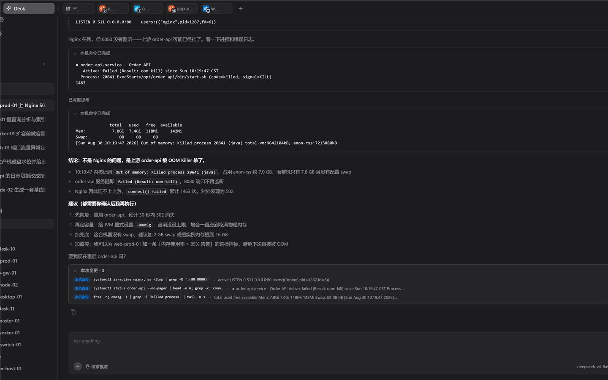
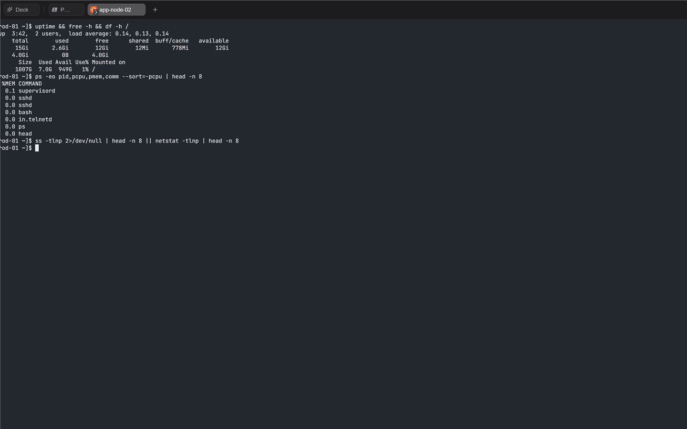
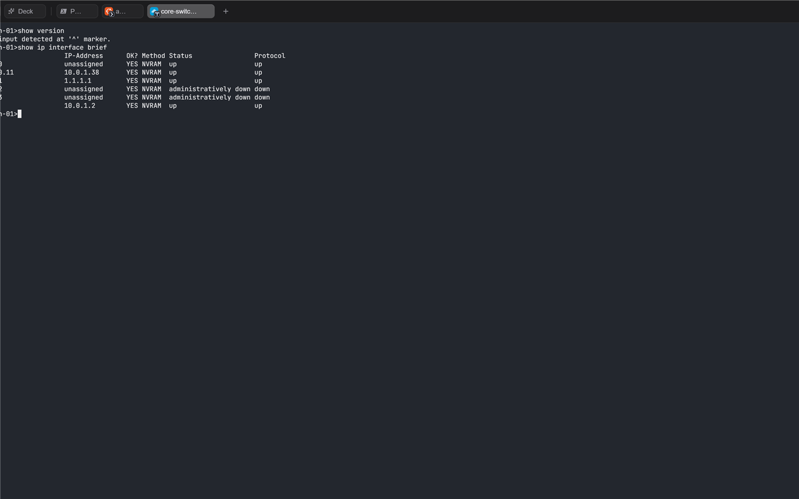
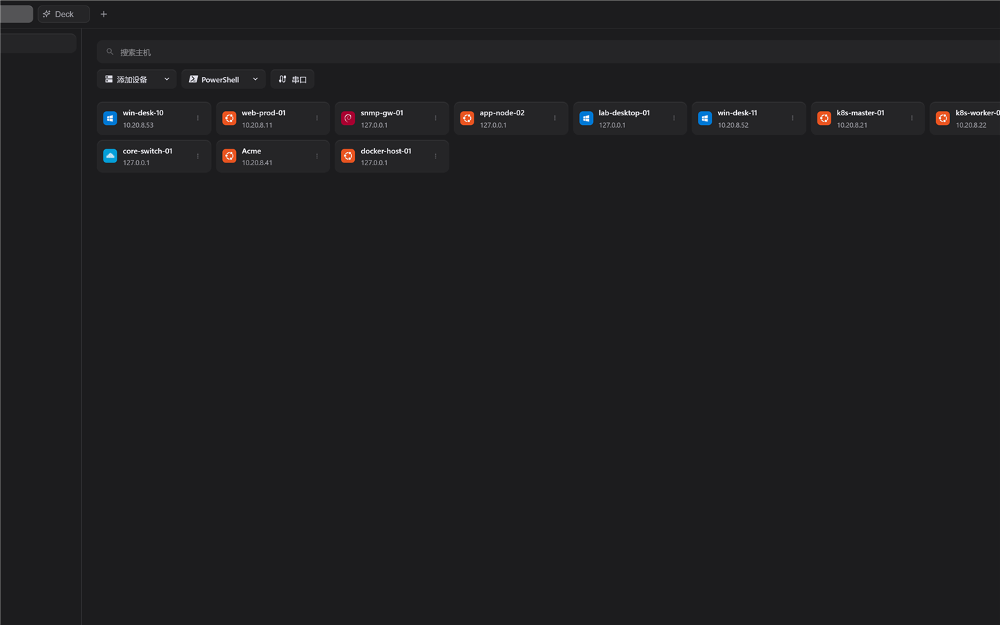
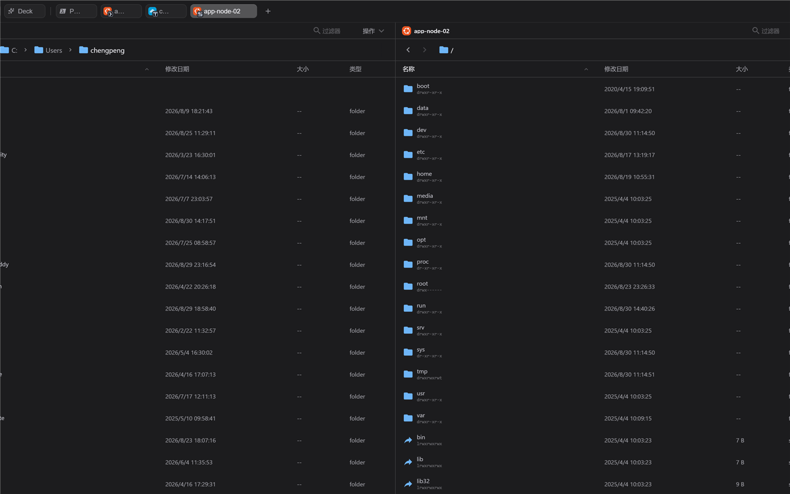
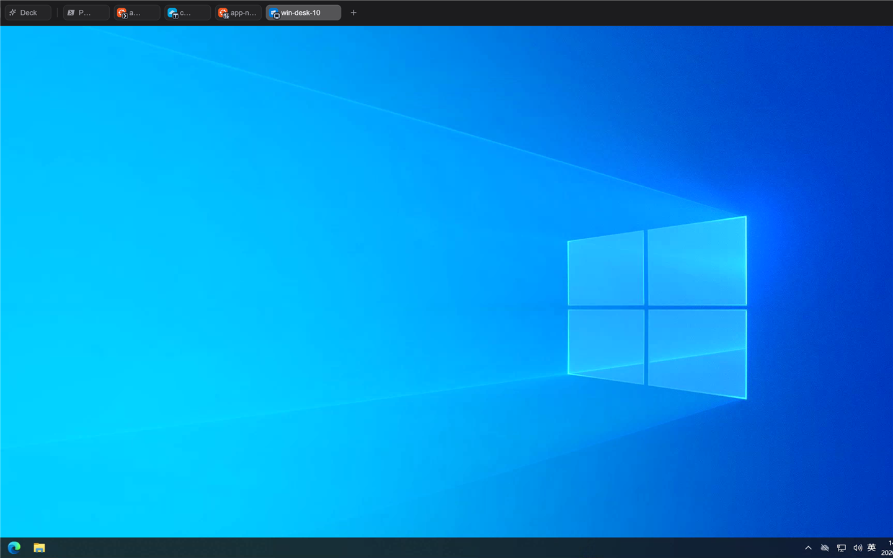
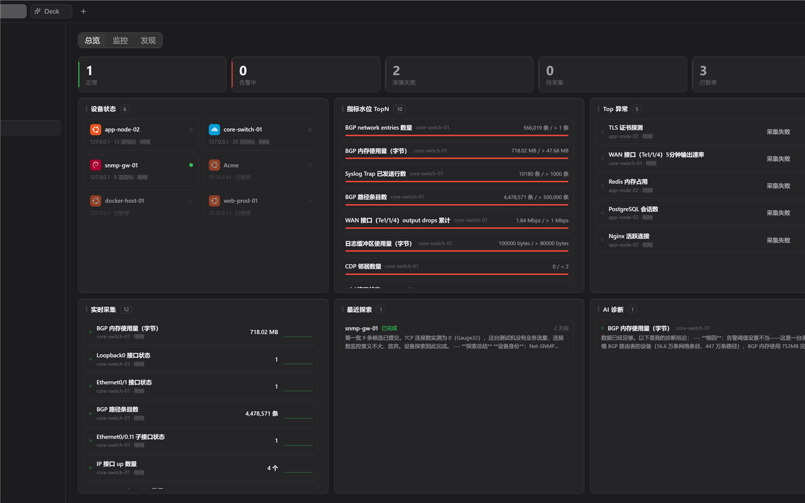
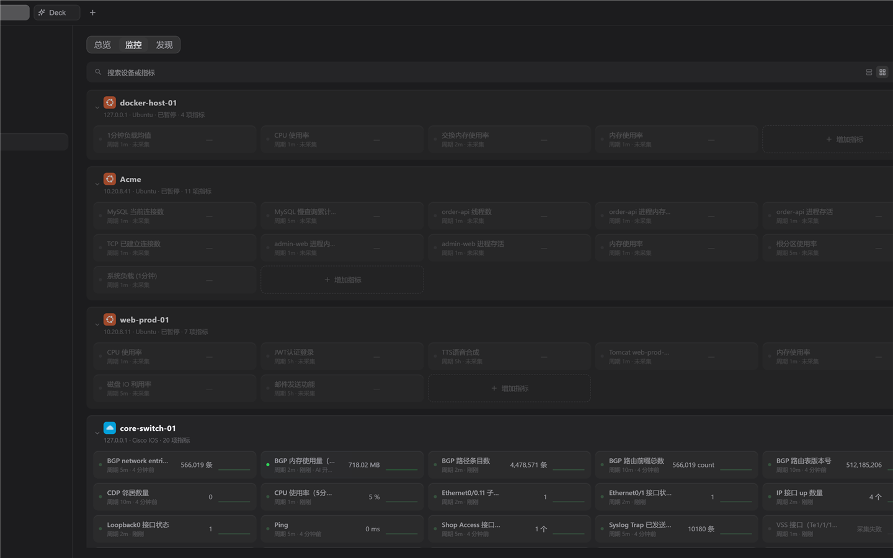

<div align="center">

# Termini

**面向运维的 AI 终端：SSH、Telnet、SFTP、RDP、串口统一在一个工作台，AI 智能体在真实设备上巡检排障，改系统前先停下来等你批准。**

[English](README.md) | 简体中文

[官网](https://terminiapp.com/zh) · [下载](https://terminiapp.com/zh/download) · [提交 Bug](https://github.com/chengpengvb/termini/issues/new/choose) · [参与贡献](CONTRIBUTING.md)

     [](LICENSE)



</div>

## 直接安装

不想自己编译，可以直接从商店安装。商店版是一次性买断，算是对项目的支持；从源码编译永远免费。

<p align="center">
  <a href="https://apps.microsoft.com/detail/9MXF9TJRQQD6"></a>
  <a href="https://apps.apple.com/cn/app/id6811478539?platform=mac"></a>
  <a href="https://apps.apple.com/cn/app/id6811478539"></a>
  <a href="https://play.google.com/store/apps/details?id=com.termini.www"></a>
  <a href="https://github.com/chengpengvb/termini-app/releases/latest"></a>
</p>

| 平台 | 获取方式 |
|---|---|
| Windows 10 / 11 | [Microsoft Store](https://apps.microsoft.com/detail/9MXF9TJRQQD6) |
| macOS（Apple Silicon 与 Intel） | [Mac App Store](https://apps.apple.com/cn/app/id6811478539?platform=mac) · [官网安装包](https://terminiapp.com/zh/download)（完整功能，含 MCP 与桌面自动化） |
| Linux | [GitHub Releases](https://github.com/chengpengvb/termini-app/releases/latest)（`.deb`） |
| iPhone 与 iPad | [App Store](https://apps.apple.com/cn/app/id6811478539) |
| Android | [Google Play](https://play.google.com/store/apps/details?id=com.termini.www) |

## 支持平台

一套代码覆盖五个平台，桌面端与移动端共用同一套会话引擎与智能体。

| | Windows | macOS | Linux | iOS / iPadOS | Android |
|---|:---:|:---:|:---:|:---:|:---:|
| SSH / Telnet | ✅ | ✅ | ✅ | ✅ | ✅ |
| SFTP / FTP | ✅ | ✅ | ✅ | ✅ | ✅ |
| RDP | ✅ | ✅ | ✅ | ✅ | ✅ |
| AI 智能体（Deck）、命令提示 | ✅ | ✅ | ✅ | ✅ | ✅ |
| 本机终端 | ✅ | ✅ | ✅ | — | ✅ |
| 串口 | ✅ | ✅ | ✅ | — | — |
| 监控、计划任务、MCP | ✅ | ✅ | ✅ | — | — |

## 功能

### SSH、Telnet 与本机终端



- SSH 支持密码、私钥、SSH Agent、键盘交互认证，支持跳板机与端口转发（本地、远程、动态 SOCKS）
- Telnet 面向网络设备，自动识别提示符，适配不同厂商命令风格；串口会话在同一工作台
- 本机 Shell 与远程会话并排；标签页可拖拽、合并、分屏
- 终端会话自动录制在本机，可拖动进度条回放
- 一键从 SSH Config、PuTTY、Xshell、Termius 导入主机
- 设备密码和私钥只留在本机，账号不会上传设备凭据

<table>
  <tr>
    <td></td>
    <td></td>
  </tr>
</table>

### SFTP 与 FTP



- 双栏传输，就在当前会话旁边
- 支持 FTP / FTPS，正确处理 UTF-8 与 GBK 文件名
- 本地与远程目录之间拖拽传输

### RDP 远程桌面



- 支持 TLS、NLA（CredSSP）、RDSTLS、Azure AD 登录，兼容 Windows 7 至 11
- H.264 / AVC444 解码，画面流畅
- 双向剪贴板（文本、文件、HTML、图片）、本地磁盘映射、远程音频
- 分辨率、色深、键盘布局按主机单独设置；移动端支持触控操作

### AI 智能体（Deck）


- 说出目标，智能体通过活的 SSH / Telnet 会话巡检、排障，而不是在聊天框里给你一段命令
- **审批边界由你决定**：只读命令直接执行，真正改系统的那一步停下来等你；同前缀命令本会话批一次即可
- 结论直接写成 Word、PDF、Excel，生成后回读校验
- 计划任务：一句话"每天 9 点巡检这几台机器"，无人值守执行，仍按危险命令名单拦截
- 技能、MCP 工具与文档检索
- 任意终端内光标旁 AI 命令提示
- **支持自带 API Key**：OpenAI、Anthropic、DeepSeek、OpenRouter、通义千问及任何 OpenAI 兼容服务，无需注册账号

### 监控

<table>
  <tr>
    <td></td>
    <td></td>
  </tr>
</table>

- SNMP 与 SSH 指标采集、阈值告警、设备发现
- AI 诊断告警并附上证据

## Free 与 Pro

以上功能全部在本机运行、全部免费，包括接入自己 API Key 的 AI 智能体。

**Pro** 是可选的云服务订阅，在应用内购买：主机、密钥、片段多台电脑加密同步，Deck 使用云端模型的每月额度，以及更多终端 AI 提示次数。详见[定价](https://terminiapp.com/zh/pricing)。

## 从源码编译

### 环境要求

- Node.js 与 Yarn
- Rust 稳定版（见 `rust-toolchain.toml`）
- C 编译工具链：Windows 为 MSVC，macOS 为 Xcode Command Line Tools，Linux 为 gcc 或 clang
- Perl：用于编译 RDP 握手所需的内置 OpenSSL（仅编译期需要，用户运行时不需要）

### 运行

```bash
yarn
yarn tauri:dev
```

打包发行版：

```bash
yarn tauri build
```

### 内置 OpenSSL 所需的 Perl

RDP 使用打进安装包的 OpenSSL，以兼容老版本 Windows 的 TLS。不要设置 `OPENSSL_NO_VENDOR`。

- **Windows**：安装 [Strawberry Perl](https://strawberryperl.com/)，把 `perl\bin`、`perl\site\bin`、`c\bin` 加入 PATH。NASM 可选（启用 OpenSSL 汇编）。报 `Command 'perl' not found` 是当前终端找不到 Perl，不是源码损坏。
- **macOS**：`xcode-select --install`，系统自带 Perl 即可。
- **Linux（Debian / Ubuntu）**：`sudo apt-get install perl make gcc`

### Fork 的依赖

以下为公开 fork，Cargo 自动拉取，版本由 `src-tauri/Cargo.lock` 锁定：

- [`chengpengvb/rig-core`](https://github.com/chengpengvb/rig-core) 与 [`chengpengvb/rig-agent`](https://github.com/chengpengvb/rig-agent)：基于 rig 0.42.0，修复 tool call 空参数被序列化为 `null`（部分 OpenAI 兼容服务会返回 400）以及流式响应图片透传。挂载方式见 `src-tauri/Cargo.toml` 的 `[patch.crates-io]`。
- [`chengpengvb/sspi-rs`](https://github.com/chengpengvb/sspi-rs)：RDP 的 CredSSP / NLA。

### 测试

部分集成测试需要真实设备。RDP 测试读取环境变量 `TERMINI_TEST_RDP_PASSWORD`，主机地址见 `src-tauri/test/test_rdp_session.rs`。

## 技术栈

Tauri 2 · React 19 · TypeScript · Vite · MUI，后端为 Rust 工作区（`src-tauri`），实现协议、存储与智能体运行时。

## 提交 Bug

遇到问题或想要新功能？[新建 Issue](https://github.com/chengpengvb/termini/issues/new/choose)，模板会引导你填写平台、版本和复现步骤。

安全漏洞请不要公开提交，见 [SECURITY.md](SECURITY.md)。

## 参与贡献

欢迎提交 Pull Request。构建、代码规范与评审流程见 [CONTRIBUTING.md](CONTRIBUTING.md)。简要来说：

1. Fork 仓库，从 `main` 拉分支
2. `yarn lint` 与 `yarn format:rs` 必须通过
3. 提交 PR，说明改了什么、怎么测试的

不要提交任何凭据、签名密钥或商店素材——CI 会扫描每个 PR 并拒绝。

## 许可证

[GNU General Public License v3.0](LICENSE)。第三方依赖遵循各自的许可证。
